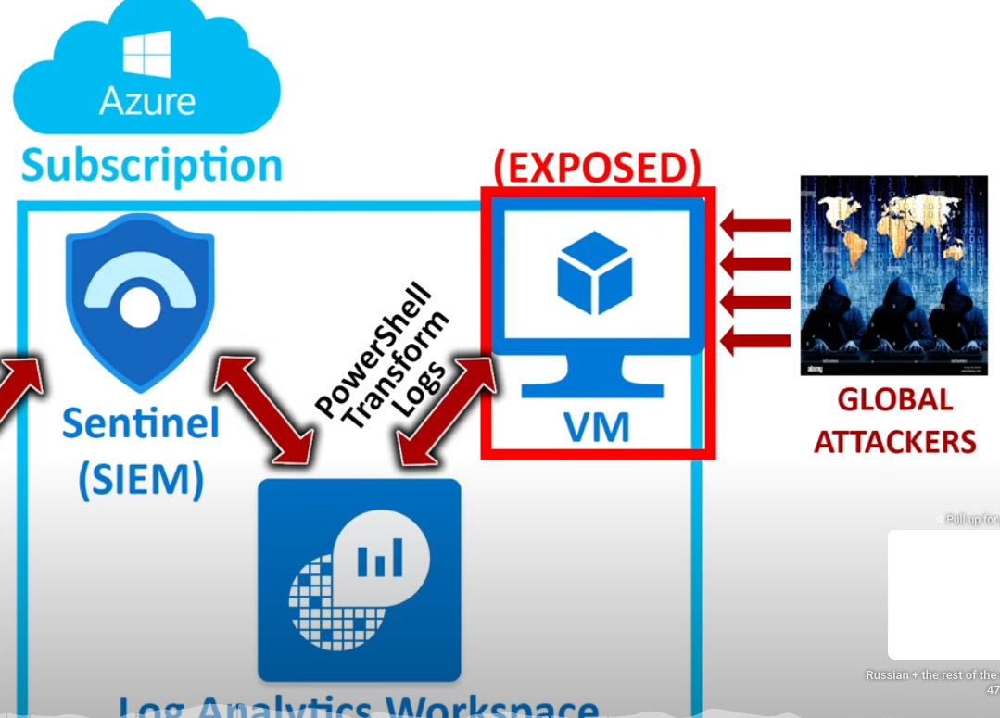
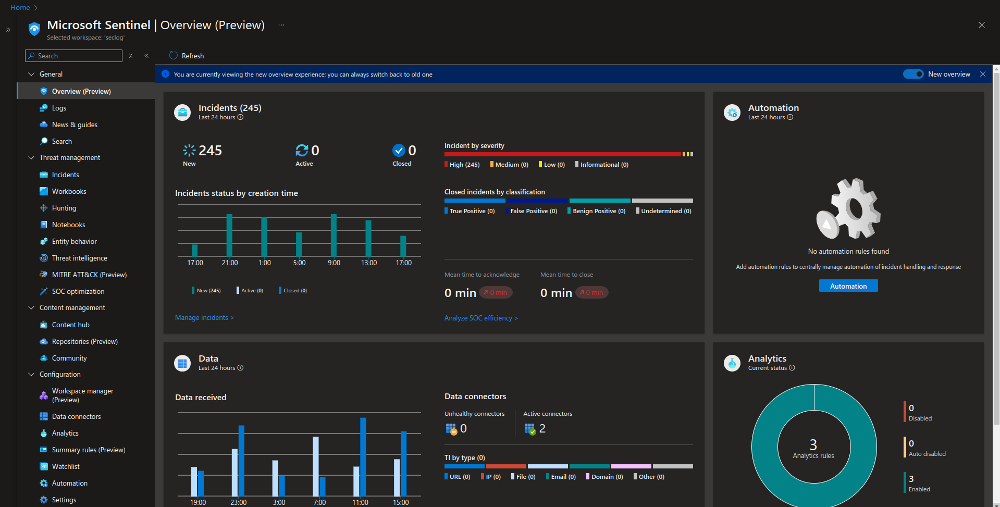
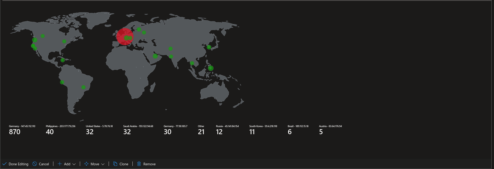

## Azure Sentinel Honeypot

Azure Sentinel is a scalable, cloud-native SIEM solution that enables real-time threat detection and response. It integrates advanced analytics, machine learning, and AI capabilities to monitor security events and detect anomalies across a wide range of environments.

### Key Features:

- Centralized log collection and analysis.
- AI-powered threat detection.
- Real-time dashboards and visualization tools.
- Integration with Microsoft and third-party security solutions.

## Purpose of the Virtual Honeypot

A virtual honeypot is a decoy system designed to attract cyber attackers. It appears as a vulnerable machine but is, in reality, closely monitored to capture information about attack methods, sources, and intentions.

### Objectives:

- Identify and log attack attempts from various IP addresses.
- Analyze the geographical distribution of attacks.
- Gather insights into attack patterns and behaviors.

## Setup Process

### 1. Deploying Azure Sentinel

#### Create an Azure Sentinel Instance:
- Navigate to the Azure portal.
- Select Azure Sentinel and associate it with a Log Analytics workspace.
- Configure data connectors for log ingestion.

#### Integrate Data Sources:
- Connect data from Azure resources, on-premises systems, or third-party solutions.
- Enable built-in connectors for Azure AD, Microsoft Defender, and other tools.

#### Set Up Analytics and Alerts:
- Create custom alert rules to detect specific threats.
- Use built-in templates for common use cases.

### 2. Configuring the Virtual Honeypot

#### Create a Virtual Machine (VM):
- Deploy a VM in Azure, ensuring it mimics a vulnerable system.
- Install minimal security measures to make it appealing to attackers.

#### Expose the Honeypot:
- Open ports and services commonly targeted by attackers, such as SSH (port 22) or RDP (port 3389).
- Deploy decoy applications to simulate real-world environments.

#### Enable Logging:
- Configure logging for system events, network activity, and user interactions.
- Forward logs to Azure Sentinel for analysis.

## Monitoring and Analysis

### 1. Real-Time Attack Logging

Azure Sentinel collects logs from the honeypot and aggregates them in the Log Analytics workspace.

Commonly monitored data includes:
- Source IP addresses of attackers.
- Types of attacks (e.g., brute force, SQL injection).
- Frequency and timing of attack attempts.

### 2. Visualization and Reporting

- Use Azure Sentinel’s dashboard to create interactive maps showing attack origins.
- Generate detailed reports on attack trends, highlighting:
  - Geographical distribution.
  - Time-based activity patterns.
  - Most targeted services and vulnerabilities.

## Conclusion

By leveraging Azure Sentinel and a virtual honeypot, organizations can gain valuable insights into cyber threats, enhance their defensive strategies, and contribute to a broader understanding of global attack patterns. This proactive approach enables better preparation against potential security breaches, ensuring a more resilient cybersecurity posture.
